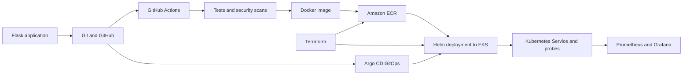

# Final DevOps Project

An educational end-to-end delivery project for a stateless Flask application. It demonstrates source control, automated testing, DevSecOps checks, container publishing, Kubernetes/Helm deployment, AWS infrastructure, monitoring, GitOps, and incident troubleshooting.

For the PowerShell deployment sequence and screenshots, see [DEPLOY.md](DEPLOY.md). Troubleshooting exercises are in [TROUBLESHOOTING.md](TROUBLESHOOTING.md).

For Ubuntu/WSL local validation and Minikube deployment in one guided run, use `bash ./run-local.sh`. It pauses at screenshot checkpoints and does not create AWS resources.

## Project overview and architecture



The application is stateless and does not require persistent volumes. The sample Ingress requires a separately installed/configured AWS Load Balancer Controller, a real hostname, and TLS configuration; it is disabled by default. HPA requires metrics-server.

## Technologies

| Area | Tools |
|---|---|
| Application | Python 3.11, Flask, Gunicorn |
| Build and registry | Docker, Amazon ECR |
| CI/CD | GitHub Actions |
| Infrastructure | Terraform, AWS VPC, EKS, IAM |
| Orchestration | Kubernetes, Helm |
| SAST / SCA / secret scan / image scan | Bandit / pip-audit / Gitleaks / Trivy |
| Monitoring | Prometheus Operator, Prometheus, Grafana, Alertmanager |
| GitOps | Argo CD; Kustomize alternative |

## Application setup

From the project root in Windows PowerShell:

```powershell
py -3.11 -m venv .venv
.\.venv\Scripts\Activate.ps1
python -m pip install -r application\requirements.txt pytest
python -m pytest tests -v
python application\app.py
```

Browse `http://localhost:5000/`, `/health`, `/ready`, and `/metrics`. The metrics endpoint exports simple process-local counters and uptime for demonstration; it is not a production multi-worker metrics backend.

## Docker setup

Build and run from the repository root:

```powershell
docker build -f docker\Dockerfile -t devops-app:1.0.0 .
docker run --rm -p 5000:5000 devops-app:1.0.0
```

The image uses a non-root runtime user, a multi-stage dependency install, and a Python-based health check. The build uses the root `.dockerignore`.

## Kubernetes deployment

The standalone manifests are in `kubernetes/`. Build the `devops-app:1.0.0` image and ensure it is available to the selected Kubernetes cluster. Apply the namespace, ConfigMap, Secret, ServiceAccount, Deployment, and Service in that order. The sample HPA additionally requires metrics-server. The Ingress additionally requires a functioning AWS Load Balancer Controller and real hostname/TLS setup.

Verify with:

```powershell
kubectl get deployments,pods,services,configmaps,secrets -n devops-prod
kubectl rollout status deployment/devops-app -n devops-prod
```

For a local cluster, Helm is the easier deployment path and is detailed below.

## Helm deployment

The chart is in `helm/`; defaults are safe for a local cluster and disable Ingress. Example local Docker Desktop deployment:

```powershell
helm lint .\helm
helm upgrade --install devops-app .\helm `
  --namespace devops-dev --create-namespace `
  --values .\helm\values-dev.yaml `
  --set image.repository=devops-app `
  --set image.tag=1.0.0 `
  --set image.pullPolicy=Never
kubectl get deployments,pods,services -n devops-dev
kubectl port-forward svc/devops-app-service 8080:80 -n devops-dev
```

The chart uses the Helm release namespace rather than a hard-coded namespace. Dev values disable Ingress and HPA; production values enable HPA and retain Ingress disabled until its AWS prerequisites are configured.

## Terraform infrastructure

`terraform/` provisions an AWS VPC with public/private subnets and NAT routing, an EKS cluster and managed node group, an ECR repository, and an OIDC role for GitHub Actions. The role can push/pull only the configured ECR repository and has EKS cluster access for deployment. Terraform uses local state by default; protect and back up state, and do not commit `terraform.tfstate` or `terraform.tfvars`.

```powershell
Copy-Item terraform\terraform.tfvars.example terraform\terraform.tfvars
# Edit github_repository and restrict cluster_endpoint_public_access_cidrs.
Set-Location terraform
terraform init
terraform validate
terraform plan -out=tfplan
terraform apply tfplan
terraform output
```

AWS resources are billable. Review the plan, restrict public API access, and destroy resources when finished. See [DEPLOY.md](DEPLOY.md) for the full flow.

## CI/CD pipeline

Workflow: `.github/workflows/ci-cd.yml`. Pull requests run tests, Bandit, pip-audit, and Gitleaks. Pushes to `main` continue to build/push an image tagged with the commit SHA, scan it using Trivy, apply the security gate, and deploy with Helm.

Configure:

- GitHub repository secret `ACTIONS_ROLE_ARN` from Terraform output.
- The workflow uses AWS region `us-east-1`, matching the Terraform deployment.
- Repository variable `ECR_REPOSITORY` (optional; defaults to the repository name `devops-app`, not its full URI).
- The Terraform `github_repository` value must match the exact GitHub owner/repository. The OIDC trust permits `main` only.
- Replace the documentation-only EKS CIDR in `terraform.tfvars` with trusted static egress addresses. Standard GitHub-hosted runners do not have a stable egress IP; use a self-hosted runner in the VPC or a runner with stable egress to reach a restricted EKS API.

Choose one deployment owner per release/namespace. Do not run the direct Helm deployment job and Argo CD auto-sync against the same release at the same time: Argo CD can revert an image tag deployed directly by CI. For GitOps mode, update the image tag in Git and use Argo CD as the sole deployer.

The AWS deployment leaves Ingress disabled; the workflow installs metrics-server for HPA. EKS worker nodes use their IAM role to pull the ECR image; no expiring image pull secret is created.

## DevSecOps implementation

| Check | Tool | Gate |
|---|---|---|
| Static application analysis | Bandit | Fails on medium/high severity findings (`-ll`) |
| Dependency analysis | pip-audit | Fails on known vulnerable dependencies |
| Secret scanning | Gitleaks | Fails on detected secrets |
| Container scan | Trivy | Blocks CRITICAL/HIGH image vulnerabilities |

Reports are uploaded as workflow artifacts where generated. Local commands and the fail-closed gate script are in [DEPLOY.md](DEPLOY.md) and `security/security-gate.sh`. Use real secret-management systems for production; the checked-in Kubernetes Secret contains blank demo values only.

## Monitoring, logs, and metrics

The app exposes `/metrics`, `/health`, and `/ready`. `monitoring/service-monitor.yaml` and `monitoring/alert-rules.yml` are Prometheus Operator resources; install `kube-prometheus-stack` before applying them. Import `monitoring/grafana-dashboard.json` in Grafana. `monitoring/prometheus.yml` is an example standalone Prometheus configuration, not a Kubernetes manifest. Kubernetes container logs can be inspected with `kubectl logs`.

See [DEPLOY.md](DEPLOY.md) for stack installation, port-forwarding, and dashboard access.

## GitOps

`gitops/argocd-application.yaml` defines an Argo CD Application that syncs the Helm chart from Git. Replace the example Git URL and ECR URI/tag, ensure Argo CD can read the repository, and make sure the cluster nodes can pull the image. Automated sync, pruning, and self-healing are enabled. `gitops/kustomization.yaml` is an alternative using the standalone Kubernetes manifests; replace its example image URI before applying.

## Troubleshooting

The repository contains fixed, deployable starting configurations. [TROUBLESHOOTING.md](TROUBLESHOOTING.md) describes scenarios to inject during the lab, rather than claiming those defects are currently active. Investigate with `kubectl describe`, `kubectl logs`, and `kubectl get events`; document symptom, evidence, root cause, fix, and verification.

## Screenshots

Add screenshots under `screenshots/` and update this table during the lab. Avoid capturing credentials or tokens.

| Screenshot | Evidence |
|---|---|
| `01-tests.png` | Passing unit tests |
| `02-application.png` | Application and health endpoint |
| `03-docker.png` | Running Docker container |
| `04-kubernetes-helm.png` | Helm release and Kubernetes resources |
| `05-actions-security.png` | Successful pipeline and scan results |
| `06-terraform.png` | Reviewed infrastructure plan/output |
| `07-monitoring.png` | Prometheus target and Grafana dashboard |
| `08-gitops.png` | Argo CD Synced/Healthy status |
| `09-troubleshooting.png` | Failure investigation and recovery |

## Lessons learned

- Provision prerequisites and verify cloud IAM before deploying workloads.
- Enforce security checks before publishing or deploying an image.
- Use commit-SHA image tags to make deployments traceable and repeatable.
- Match probe paths, Service ports, resource requests, and HPA metrics to the application.
- Keep secrets and Terraform state out of Git; use scoped credentials and GitHub OIDC.
- Treat monitoring and GitOps controllers as infrastructure that must be installed and configured, not just manifests to apply.
- Reproduce failures deliberately, collect evidence, fix root causes, and verify recovery.

## Repository structure

```text
application/       Flask app and tests
docker/            Dockerfile
kubernetes/        Standalone Kubernetes manifests
helm/              Helm chart and environment values
terraform/         AWS infrastructure
.github/workflows/ CI/CD workflow
security/          Scanner configuration and security gate
monitoring/        Prometheus resources, dashboard, example config
gitops/            Argo CD Application and Kustomize alternative
DEPLOY.md          Step-by-step deployment and screenshot guide
run-local.sh       Guided Ubuntu/WSL local test and Minikube deployment
TROUBLESHOOTING.md Troubleshooting lab
```
